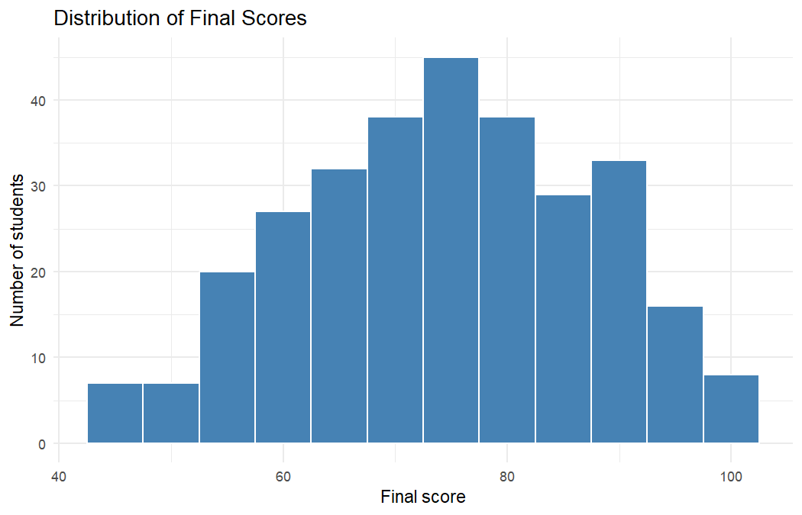
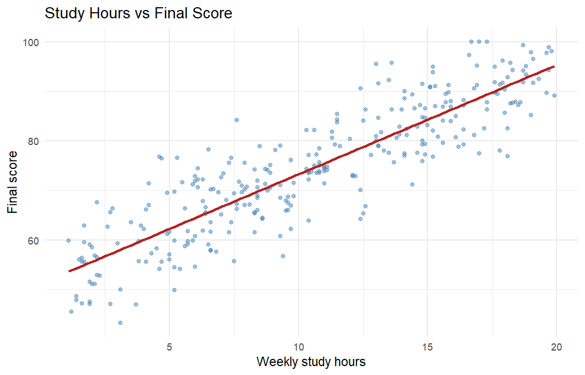

> **AI Assistance Declaration**: I used ChatGPT (GPT 5.6 Luna) to brainstorm the README structure, draft this README and suggest formatting for the `.Rmd` file, and Claude (Sonnet 5.5, Anthropic) to help design the example project, draft the two R scripts and the `.Rmd`, review the README, and draft `Reflection.md` and `Appendix.md`. Prompts used: the full list is in `Appendix.md`, and the main ones are summarized in the AI Assistance Disclosure section at the bottom of this file. I verified outputs using GitHub's Markdown preview, by running both scripts in RStudio, by knitting `analyze_scores.Rmd`, by comparing my section list with the tidyverse dplyr README, and by cross-checking one course average in Google Sheets. All final calculations are done by myself. I am responsible for the accuracy and originality of this work.

# Synthetic Student Scores Analysis

A small R project that generates a synthetic dataset of 300 students, compares average scores across four courses, and looks at how study hours relate to final scores. It was built for BDA400 Assignment 1 (Markdown Buddy) to practice documenting an R project.

## Objectives

- Generate a reproducible synthetic dataset of 300 students.
- Calculate the mean and median final score for each course.
- Visualize the distribution of final scores.
- Explore the relationship between study hours and final scores.

## Dataset

`scripts/generate_data.R` creates the data and saves it as `data/student_scores.csv`. The script calls `set.seed(2026)`, so every run produces the same file. No real or personal data is used.

| Column        | Description                                              |
| ------------- | -------------------------------------------------------- |
| `student_id`  | Unique student identifier (S001 to S300)                 |
| `course`      | One of Statistics, Databases, Programming, Data Visualization |
| `study_hours` | Weekly study hours, between 1 and 20                     |
| `attendance`  | Attendance percentage, between 60 and 100                |
| `final_score` | Final score out of 100                                   |

## Tools and Technologies

- R
- readr, dplyr, ggplot2
- rmarkdown and knitr (for the `.Rmd` documentation)

## Project Structure

```
markdown-buddy-tasveerkanwal/
├── data/
│   └── student_scores.csv
├── scripts/
│   ├── generate_data.R
│   └── analyze_scores.R
├── outputs/
│   ├── course_summary.csv
│   ├── score_distribution.png
│   └── hours_vs_score.png
├── analyze_scores.Rmd
├── Reflection.md
├── Appendix.md
├── .gitignore
├── LICENSE
└── README.md
```

## Installation

1. Install [R](https://cran.r-project.org/) and [RStudio](https://posit.co/download/rstudio-desktop/).
2. Clone the repository:

   ```
   git clone https://github.com/tasveerkanwal/markdown-buddy-tasveerkanwal.git
   cd markdown-buddy-tasveerkanwal
   ```

3. Install the required packages in R:

   ```r
   install.packages(c("readr", "dplyr", "ggplot2", "rmarkdown", "knitr"))
   ```

## How to Run

Run everything from the project root folder.

```r
source("scripts/generate_data.R")
source("scripts/analyze_scores.R")
```

The first line rebuilds `data/student_scores.csv`. The second prints the course summary and writes the plots and summary table to `outputs/`. To render the documented walkthrough of the analysis script:

```r
rmarkdown::render("analyze_scores.Rmd")
```

## Example Code

The core of `scripts/analyze_scores.R` is a grouped summary:

```r
library(readr)
library(dplyr)

scores <- read_csv("data/student_scores.csv", show_col_types = FALSE)

scores |>
  group_by(course) |>
  summarise(
    students = n(),
    mean_score = round(mean(final_score), 1),
    median_score = round(median(final_score), 1)
  ) |>
  arrange(desc(mean_score))
```

## Visualizations and Results

### Course summary

| Course             | Students | Mean score | Median score | Mean study hours |
| ------------------ | -------: | ---------: | -----------: | ---------------: |
| Programming        |       60 |       75.4 |         74.2 |             11.0 |
| Data Visualization |       80 |       75.3 |         75.2 |             11.1 |
| Statistics         |       88 |       75.3 |         73.7 |             11.0 |
| Databases          |       72 |       71.8 |         73.0 |              9.0 |

### Distribution of final scores



### Study hours and final score



## Key Insights

- Study hours and final score have a strong positive correlation (r = 0.88).
- Databases has the lowest average score (71.8), and its students also report the fewest study hours (9.0 on average).
- Mean scores for the other three courses sit within 0.1 points of each other.
- The data is synthetic and `final_score` is built from study hours, attendance and random noise, so the strong correlation reflects how the data was generated and says nothing about real students.

## Limitations and Future Work

- The dataset is synthetic and does not represent real student performance.
- The analysis is descriptive. The regression line shows association, not cause.
- Future work could add attendance to the analysis, hypothesis tests between courses, and a predictive model.

## Author

tasveerkanwal ([GitHub](https://github.com/tasveerkanwal))

## License

Released under the [MIT License](LICENSE).

## AI Assistance Disclosure

**Tools used**

- ChatGPT (GPT 5.6 Luna), 17 October 2026: README section ideas, the README draft, and formatting suggestions for the `.Rmd` file.
- Claude (Sonnet 5.5, Anthropic), 17 October 2026: project design, the two R scripts, the `.Rmd` file, review of the README draft, and first drafts of `Reflection.md` and `Appendix.md`.

**Main prompts**

1. "Explain what sections a good GitHub README for an R data analysis project should include."
2. "Revise the sections list so it's concise and uses Markdown headers and bullet formatting."
3. "Check the Markdown syntax for correctness and readability."
4. A project summary followed by "Generate a professional README.md file using Markdown."
5. "Add sections for Installation, Example Code, and License. Keep tone concise and professional."
6. "Review the Markdown for syntax errors and suggest 2 improvements for clarity."
7. A description of `analyze_scores.R` followed by "Suggest Markdown formatting and code block examples."
8. "Add syntax highlighting and improve section organization (e.g., # Purpose, ## Inputs, ## Outputs)."
9. "Is the Markdown consistent with RMarkdown best practices?"

The exact wording of every prompt and the key responses are in `Appendix.md`.

**Changes I made after reviewing the outputs**

- Replaced ChatGPT's guessed plot filenames with the real ones the script creates (`score_distribution.png`, `hours_vs_score.png`, `course_summary.csv`).
- Replaced the placeholder repository name and username with the real ones.
- Rewrote the example code to match `analyze_scores.R` (native pipe, no unnecessary `na.rm`).
- Followed the critique: the Dataset section now names `generate_data.R` and the seed, and the project has a real MIT `LICENSE` file instead of a vague licence statement.
- Replaced the generic Key Insights with results from my own run and added a caveat about synthetic data.
- Embedded the saved plots and added the course summary table.
- Removed the "illustrative" notes, the "Before publishing" reminder, the placeholder author name and the LinkedIn placeholder.
- Added rmarkdown and knitr to the dependencies and listed the `.Rmd` file in the project structure.
- For `analyze_scores.Rmd`, kept ChatGPT's Purpose, Inputs, Outputs and Dependencies layout but turned it into a proper R Markdown file with a YAML header, a table of contents and chunks that actually run.
- Corrected the filenames and the pipe style in ChatGPT's script examples again, and removed its README-style example blocks that duplicated this file.
- Knitted the `.Rmd` in RStudio to check that headers, tables, plots and code chunks render.
